# ⚡ Awesome High-Concurrency Parallel Test Execution 🚀

  
  
  
  
  
  
  

---

## 🎯 Top High-Concurrency Parallel Test Execution Ecosystem

> **A curated showcase of SaaS platforms, distributed cloud grids, CI/CD sharding engines, and open-source frameworks for running ultra-fast automated tests at massive scale.** 🏎️💨  
> *Last updated: March 2026*

Running massive automated test suites in continuous integration (CI/CD) often becomes the primary bottleneck in modern software delivery. **High-Concurrency Parallel Test Execution** resolves this by sharding suites across parallel processes, distributed worker containers, and elastic browser clouds—shrinking multi-hour pipelines down to minutes.

Whether you are seeking commercial cloud grids scaling to thousands of concurrent devices, Kubernetes-native test execution operators, or intelligent timing-based test balancers, this guide curates the industry leaders and best-of-breed open-source options.

---

## 📑 Table of Contents
- [📊 Sector Overview & Market Dynamics](#-sector-overview--market-dynamics)
- [☁️ SaaS & Hosted Cloud Platforms](#️-saas--hosted-cloud-platforms)
- [🛠️ Open-Source GitHub Projects](#️-open-source-github-projects)
- [🤝 How to Contribute](#-how-to-contribute)
- [💖 Support & Sponsorship](#-support--sponsorship)
- [📈 Star History](#-star-history)
- [⚠️ Disclaimer](#️-disclaimer)

---

## 📊 Sector Overview & Market Dynamics

The cloud-based testing and test automation market is valued between **$13 billion and $15 billion** (projected to reach over $35 billion by 2034 at an estimated 12–14% CAGR), accelerated by continuous delivery demands and AI-driven test orchestration. The sector remains **moderately to highly fragmented** rather than winner-take-all; it is divided among enterprise hyperscalers, specialized browser/device grid providers, dedicated CI/CD platforms, and an active open-source ecosystem, with vendors competing across managed cloud grids, cost-per-parallel pricing, and self-hosted orchestration.

---

## ☁️ SaaS & Hosted Cloud Platforms

*Ranked in descending order of company valuation and operational scale.*

| Product | Company Size (Valuation / Revenue) | Description | Starting Pricing | Free Tier / Free Trial Limits |
|:---|:---|:---|:---|:---|
| **[GitHub Actions Matrix](https://github.com/features/actions)** | **$7.5B+ acquisition valuation** (~$2B+ ARR run-rate via Microsoft) | Native CI/CD engine with **matrix builds** for parallel job execution across isolated runners. Public repos get unlimited free minutes. | Paid Linux runners start at **$0.008/minute** (2-core) | **Permanent Free Tier**: 2,000 minutes/month for private repos; unlimited minutes for public repos |
| **[BrowserStack Parallel Testing](https://www.browserstack.com/)** | **$4.0B valuation** (~$230M ARR) | Global cloud grid with 3,000+ real desktop browsers and 30,000+ physical mobile devices. Plans priced per parallel session with unlimited minutes. | Automate Desktop starts at **$59/month** (annual, 1 parallel session) or $29/month for manual Live | **Free Trial Only**: 100 minutes of automated cross-browser testing; 30 minutes of manual Live testing (capped at 1 min/session); unlimited free for qualifying open-source |
| **[CircleCI Test Splitting](https://circleci.com/)** | **$1.7B valuation** (~$55M+ ARR) | Cloud CI/CD platform featuring **timing-based test splitting** across parallel containers using historical timing metadata. | Scale/Performance plans start at **$15/month** base + $0.0006/credit | **Permanent Free Tier**: 30,000 free credits/month (up to ~6,000 build minutes) for up to 5 active users |
| **[Sauce Labs Concurrent Testing](https://saucelabs.com/)** | **~$613M valuation** (~$65M–$95M ARR) | Enterprise cloud testing grid offering Virtual Device Cloud (emulators/simulators) and Real Device Cloud (physical hardware). | Virtual Device Cloud starts at **$149/month** (annual, 1 parallel session); Live testing starts at $39/month | **Free Trial Only**: 28-day free trial including 60 automated/live testing minutes and up to 3 parallel virtual machines |
| **[HyperExecute (TestMu AI)](https://www.lambdatest.com/hyperexecute)** | **~$400M valuation** (~$120M–$150M ARR parent company LambdaTest) | High-speed test orchestration engine with **virtually unlimited parallel nodes across multiple clouds**. | HyperExecute starts at **$103/month** per parallel session (annual, Linux) or $159/month (Windows/macOS) | **Permanent Free Tier**: 300 HyperExecute minutes/month + 2 concurrent sessions |
| **[LambdaTest Parallel Testing](https://www.lambdatest.com/)** | **~$400M valuation** (~$120M–$150M ARR) | Cloud grid offering 10,000+ browser/OS combinations with real-time logging, video recording, and analytics. | Automation starts at **$79/month** (annual, 1 parallel desktop browser) or $15/month for manual Live | **Permanent Free Tier**: 100 lifetime automation minutes + 2 parallel sessions; 60 minutes/month manual Live testing (10 min/session) |
| **[Aerokube Moon](https://aerokube.com/moon/)** | **Bootstrapped / Boutique** (~$1M–$5M estimated revenue) | Kubernetes-native browser automation cloud supporting Selenium, Playwright, Puppeteer, and Cypress in a single cluster. | Paid licenses start at **$5/month per parallel session** | **Permanent Free Tier**: Free forever for up to 4 parallel browser sessions; unlimited-session evaluation license keys available for pre-production testing |

---

## 🛠️ Open-Source GitHub Projects

*Ranked in descending order of GitHub community stars. Each badge links directly to the project's stargazers.*

| Project | Star Badge | Description |
|:---|:---:|:---|
| **[Playwright](https://github.com/microsoft/playwright)** |  | **The gold standard for high-concurrency cross-browser automation with zero additional license cost.** **Apache-2.0**, Microsoft-maintained. Provides native worker-level multithreading on a single runner (`workers`) alongside suite-level `--shard` flags for distributing across CI machines. Supports `fullyParallel: true`, automated blob report merging, and test locks (`lock: 'resource-name'`) for shared environments. |
| **[Selenium](https://github.com/SeleniumHQ/selenium)** |  | **The reference hub-and-node architecture for distributed WebDriver execution.** **Apache-2.0**. Selenium Grid 4 distributes test commands across independent physical or containerized nodes, featuring dynamic driver management, distributed OpenTelemetry tracing, and GraphQL status inspection. |
| **[k6](https://github.com/grafana/k6)** |  | **High-performance, developer-centric load and concurrency testing tool in Go and JavaScript.** **AGPL-3.0**, Grafana Labs. Capable of driving tens of thousands of concurrent virtual users (VUs) with minimal memory footprint; integrates natively into CI/CD pipelines to validate parallel execution thresholds under high concurrency. |
| **[Locust](https://github.com/locustio/locust)** |  | **Scalable, distributed user-load and concurrent execution testing framework in pure Python.** **MIT-licensed**. Uses an event-driven coroutine model (gevent) to simulate millions of simultaneous users across a distributed cluster of worker nodes communicating with a master node. |
| **[AVA](https://github.com/avajs/ava)** |  | **Node.js test runner designed from the ground up for concurrent test execution.** **MIT-licensed**. Runs every JavaScript/TypeScript test file in a separate, isolated worker process concurrently to enforce test isolation and achieve blazing-fast execution speeds. |
| **[parallel_tests](https://github.com/grosser/parallel_tests)** |  | **Multi-process concurrency test runner for Ruby (RSpec, Test::Unit, Cucumber, Spinach).** **MIT-licensed**. Splits test suites across multiple CPU cores with dedicated test database isolation per process (`TEST_ENV_NUMBER`), dramatically cutting test execution times. |
| **[Selenoid](https://github.com/aerokube/selenoid)** |  | **Lightweight Go-based Selenium hub launching isolated browser containers per session.** **Apache-2.0**. Spin up disposable Docker/Podman browser containers instantly with negligible CPU/memory overhead; includes built-in VNC access, video recording, and strict concurrency limit controls via `-limit`. |
| **[Zalenium](https://github.com/zalando/zalenium)** |  | **Flexible, scalable containerized Selenium Grid with on-demand scaling.** **Apache-2.0**. Automatically scales Docker containers up and down based on incoming test volume and can redirect overflowing parallel jobs to cloud grids. |
| **[pytest-xdist](https://github.com/pytest-dev/pytest-xdist)** |  | **The primary parallel and distributed testing plugin for Python pytest suites.** **MIT-licensed**. Extends pytest with distributed execution over multiple CPUs (`-n auto`) or remote machines, featuring intelligent test scheduling (`--dist loadfile`, `--dist loadscope`) and looponfail monitoring. |
| **[Testkube](https://github.com/kubeshop/testkube)** |  | **Kubernetes-native test orchestration and concurrent execution engine.** **MIT-licensed**. Executes test suites directly within your cluster without requiring custom Docker bundling. Decouples test execution from CI runners, managing parallel test CRDs across Postman, Cypress, K6, Playwright, and custom executors. |
| **[cypress-parallel](https://github.com/tnicola/cypress-parallel)** |  | **Multi-threaded Cypress test execution runner on a single machine or CI agent.** **MIT-licensed**. Slices Cypress test specs across concurrent child processes, saving up to 40% suite runtime locally or on self-hosted runners without requiring Cypress Cloud. |
| **[Grid Router (Ggr)](https://github.com/aerokube/ggr)** |  | **Ultra-scalable, stateless traffic router for large-scale Selenium Grids.** **Apache-2.0**. Aggregates multiple Selenoid or Selenium Grid instances into a single entry point capable of routing thousands of concurrent browser sessions per second. |
| **[cypress-split](https://github.com/bahmutov/cypress-split)** |  | **Fast, dynamic Cypress spec splitting across GitHub Actions matrix runners.** **MIT-licensed**. Splits Cypress tests based on file duration or counts across parallel CI jobs without external SaaS dependencies. |
| **[Fairsplice](https://github.com/dashdoc/fairsplice)** |  | **Timing-based balanced test splitting algorithm tailored for GitHub Actions.** **MIT-licensed**. Uses historical JUnit XML test durations and bin packing algorithms to group tests into evenly balanced parallel chunks (targeting variance under 10%), eliminating bottleneck jobs. |

---

## 🤝 How to Contribute

Contributions are welcome and appreciated! Help keep this ecosystem comprehensive, balanced, and up-to-date:

1. 🍴 Fork the repository.
2. 🌿 Create a new feature branch (`git checkout -b feature/add-new-tool`).
3. 📝 Add or edit entries in `README.md` following the established table structure and factual guidelines.
4. 🚀 Submit a Pull Request with a brief summary of the proposed additions.

---

## 💖 Support & Sponsorship

If this curated guide helps you architect faster CI/CD pipelines, optimize test grids, or cut cloud infrastructure costs, please consider supporting the project!

- ⭐ **Star this repository** to improve visibility for the QA and DevOps community.
- 🍴 **Fork and share** with your engineering peers and teams.
- ☕ **Buy a coffee / Sponsor the project**: Support continuous open-source maintenance and research via the [GitHub Sponsors Dashboard](https://github.com/sponsors/ishandutta2007).

---

## 📈 Star History

---

## ⚠️ Disclaimer

- This is an independent, **community-curated** list — inclusion does not represent an endorsement.
- Parallel test execution frameworks launch real browsers, subprocesses, and network requests; ensure proper test isolation, ephemeral sandbox teardown, and secret masking in your CI/CD configurations.
- **Concurrency without isolation causes flakiness, not velocity.** Always ensure your tests generate independent state, provision unique test data, and avoid hardcoded race conditions before scaling concurrency.

---

  <b>Built with ❤️ for QA Engineers, DevOps Practitioners, and CI/CD Architects worldwide.</b> 
  Let's make high-concurrency parallel test execution open, blazing-fast, and cost-predictable.

